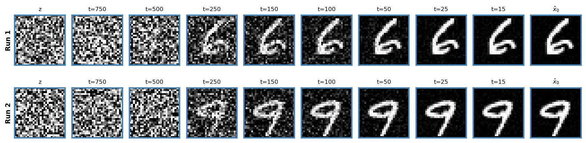
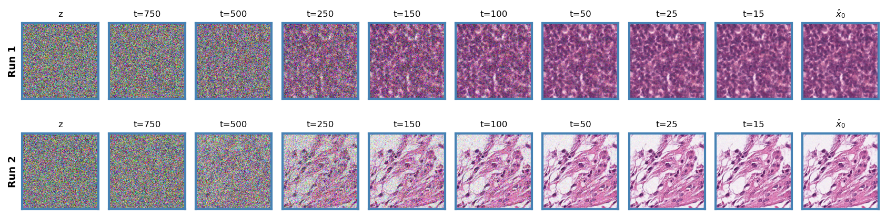
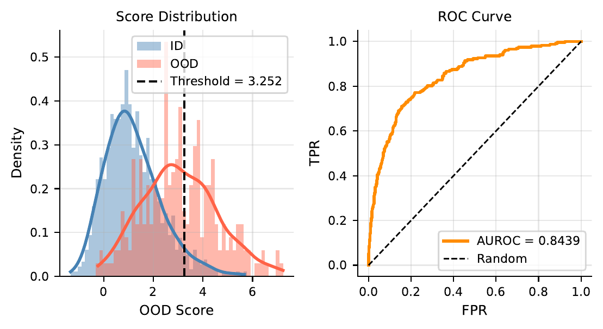
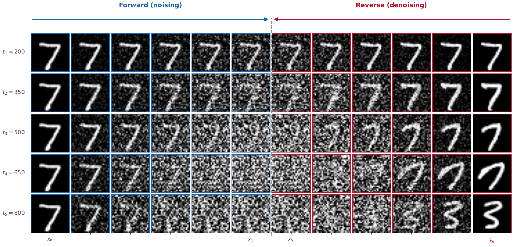

# Generative AI for Out-of-Distribution Detection in Histopathology

<p>
  
  
  
  
  
</p>

**Bachelor's thesis, Universidad de Granada, 2026 · Graded with Honours (10/10) · [Read the thesis (PDF)](EGEA_LOPEZ_ALEJANDRO-TFG_2025-26_OOD-DETECTION-GENAI.pdf)**

Can a model trained only on benign prostate tissue tell when it is shown cancer? This project trains generative models (VAEs and DDPM diffusion models) exclusively on in-distribution data and uses them to score new samples as in- or out-of-distribution, without seeing a single OOD example during training. It compares them with distance-based baselines (KNN, Mahalanobis) across datasets, backbones and scoring strategies.


|                   DDPM denoising trajectory (UNet · MNIST)                   |                    DDPM denoising trajectory (UNet · PathMNIST-C2)                    |
| :------------------------------------------------------------------------------: | :--------------------------------------------------------------------------------------: |
|  |  |

## Key findings

On SICAP, benign (Gleason 1–2) vs. cancer (Gleason 3–4), MLP backbone, averaged over 3 seeds and 3 learning rates:


| Method      | Best score                |      AUROC |       AUPR |    FPR@95% |
| ------------- | --------------------------- | -----------: | -----------: | -----------: |
| KNN         | —                        |     0.6146 |     0.1989 |     0.7608 |
| Mahalanobis | —                        |     0.8545 |     0.5876 |     0.6051 |
| VAE         | ELBO                      | **0.8640** | **0.5992** | **0.4997** |
| DDPM        | multi-step reconstruction |     0.8557 |     0.5724 |     0.5439 |

- **The VAE scored with the ELBO is the best method** on both SICAP benchmarks (AUROC 0.864 here, 0.855 on SICAP-C1), and it has the lowest false-positive rate at 95% recall.
- **A simple Mahalanobis baseline comes within 0.01–0.02 AUROC** of the generative models with no training at all, while the UNet DDPM experiments take 20–40 GPU hours each. The extra cost of generative models has to be justified case by case.
- **How you score matters as much as which model you use:** each model was evaluated with several scoring modes (reconstruction, ELBO, latent distances, noise residuals), and results change notably between them.



*DDPM scored with the multi-timestep noise error (`noise_multi_mse`): in-distribution and OOD samples fall into clearly separated score distributions (left), giving an AUROC of 0.84 (right).*

More results, ablations and the full discussion are in the [thesis](EGEA_LOPEZ_ALEJANDRO-TFG_2025-26_OOD-DETECTION-GENAI.pdf).

---

## Requirements

```bash
conda env create -f environment.yml
conda activate tfg
```

Python 3.10 · PyTorch 2.0+ · see `environment.yml` for the full dependency list.

---

## Project structure

```
.
├── configs/
│   ├── base.yaml                  # Shared defaults
│   ├── data/                      # Per-dataset configs (mnist, sicap_c1, sicap_c12, …)
│   └── experiments/               # Per-model configs (mlp/vae, mlp/ddpm, unet/*, …)
├── data/                          # Raw datasets (MNIST, PathMNIST, SICAP)
├── scripts/
│   ├── core.sh                    # Shared helpers and loop primitives
│   ├── experiments.sh             # Numbered experiment functions (exp_0 … exp_6)
│   └── run.sh                     # Entry point for multi-GPU runs
├── src/
│   ├── models/                    # VAE, DDPM, OOD scorers, base interface
│   ├── data/                      # Dataset loaders
│   ├── training/                  # Training loop, EMA, early stopping
│   ├── evaluation/                # Metrics, score extraction, plots
│   ├── benchmarking/              # Summary tables, ablation plots, training times
│   ├── artifacts.py               # W&B logging and file persistence
│   ├── config.py                  # Config building and seeding
│   ├── stages.py                  # Pipeline stages (train, eval, visualise)
│   └── viz/                       # Matplotlib style helpers
└── main.py                        # CLI entry point
```

---

## Usage

The CLI exposes three modes via `--mode`.

### Reconstruction-based methods (VAE / DDPM)

```bash
# Train + evaluate
python main.py \
  --mode reconstruction-method \
  --experiment mlp/vae/sicap \
  --dataset sicap_c1 \
  --lr 1e-4 \
  --seed 42

# Evaluate only (requires a saved checkpoint)
python main.py \
  --mode reconstruction-method \
  --experiment unet/ddpm/base \
  --dataset pathmnist_c2 \
  --lr 1e-4 \
  --seed 42 \
  --skip-train
```

Supported experiments: `mlp/vae/sicap`, `mlp/ddpm/sicap`, `mlp/vae/path`, `mlp/ddpm/path`, `mlp/ddpm/mnist`, `mlp/vae/toy`, `mlp/ddpm/toy`, `unet/vae/base`, `unet/ddpm/base`.
Supported datasets: `mnist`, `sicap_c1`, `sicap_c12`, `pathmnist_c1`, `pathmnist_c2`, `moons`, `blobs`.

### Distance-based baselines

```bash
python main.py \
  --mode distance-method \
  --dataset sicap_c1 \
  --distance-type knn      # or: mahalanobis
```

No training required. Uses the training split as the reference distribution.

### Aggregate results

```bash
python main.py \
  --mode stats-summary \
  --logs-dir results/evaluation \
  --out-csv  results/summary/comparison.csv
```

Reads all `eval_results.json` files under `--logs-dir`, writes a CSV, and generates LaTeX tables (comparison, ablation, training times) and ablation plots under `results/summary/`.

---

## Running experiments

The numbered experiment functions in `scripts/experiments.sh` reproduce the full study.

Experiments exp_3 and exp_4 (UNet on MNIST/PathMNIST) each take 20–40 h of GPU time.
Use `screen` so runs survive SSH disconnections:

```bash
# Run a single experiment group (e.g. toy datasets)
bash scripts/run.sh 1

# Typical 2-GPU split used in the thesis — run inside screen sessions
screen -S exp3
CUDA_VISIBLE_DEVICES=0 bash scripts/run.sh 3
# Ctrl+A D  to detach

screen -S exp4
CUDA_VISIBLE_DEVICES=1 bash scripts/run.sh 4
# Ctrl+A D  to detach

# Re-attach later
screen -r exp3

# Distance baselines (CPU, lightweight)
bash scripts/run.sh 0

# Generate summary after all runs finish
SUMMARIZE=1 bash scripts/run.sh
```


| Group   | Content                                        | Purpose                                              |
| --------- | ------------------------------------------------ | ------------------------------------------------------ |
| `exp_0` | KNN + Mahalanobis baselines on SICAP           | Distance-based reference, no training required       |
| `exp_1` | MLP VAE + DDPM on toy datasets (moons, blobs)  | Sanity check on controlled 2D data                   |
| `exp_2` | MLP VAE + DDPM on MNIST and PathMNIST-C1       | Benchmark on standard and histopathology images      |
| `exp_3` | UNet VAE + DDPM on MNIST                       | Convolutional backbone on standard image data        |
| `exp_4` | UNet VAE + DDPM on PathMNIST (C1, C2)          | Convolutional backbone on histopathology images      |
| `exp_5` | MLP VAE + DDPM on SICAP (multi-seed, multi-LR) | Main evaluation, results averaged across seeds       |
| `exp_6` | DDPM T-step ablation on SICAP and PathMNIST    | Sensitivity of noise-based scores to number of steps |

Override defaults with environment variables:

```bash
SEEDS="42 107 2024" LRS_VAE="1e-4 5e-4" MODEL=vae bash scripts/run.sh 4
```

---

## OOD scoring modes

### VAE


| Mode         | Description                                        |
| -------------- | ---------------------------------------------------- |
| `recon`      | Per-sample MSE reconstruction error                |
| `elbo`       | Reconstruction + β · KL divergence               |
| `latent_knn` | Distance to k-th nearest neighbour in latent space |
| `latent_mah` | Mahalanobis distance in latent space               |

### DDPM


| Mode                 | Description                                                 |
| ---------------------- | ------------------------------------------------------------- |
| `noise_single`       | MSE between predicted and actual noise at a fixed timestep  |
| `noise_multi_mse`    | Z-scored MSE aggregated over multiple timesteps             |
| `noise_multi_cosine` | Z-scored cosine distance aggregated over multiple timesteps |
| `recon_single`       | Reconstruction error after single-step denoising            |
| `recon_multi`        | Reconstruction error averaged over multiple denoising steps |
| `residual_mah`       | Mahalanobis distance in the noise-residual space            |
| `residual_knn`       | KNN distance in the noise-residual space                    |



*Multi-step reconstruction: each sample is noised up to timestep t (left, blue) and denoised back (right, red). With little noise the model recovers the original digit; with more noise it drifts towards what it has learned, and the 7 ends up as a 3. Reconstruction-based scores measure exactly this gap between the input and its reconstruction.*

---

## Configuration

All hyperparameters live in YAML files. Experiment configs inherit from `configs/base.yaml` and override what they need.

```bash
# Start from the closest existing config
cp configs/experiments/vae.yaml configs/experiments/my_run.yaml
# Edit experiment_name and any hyperparameters, then:
python main.py --mode reconstruction-method --experiment my_run --dataset mnist
```

Results are written to `results/training/<experiment_id>/` and `results/evaluation/<experiment_id>/`.

---

## W&B integration

W&B logging is enabled by default. To disable:

```yaml
# configs/base.yaml or your experiment config
wandb:
  enabled: false
```

---

## Notes

This repository is the academic release of the thesis codebase. Code style and linting are enforced in CI (see `.github/workflows/lint.yml`).

---

## License

[Apache License 2.0](LICENSE) — © 2026 Alejandro Egea López / Universidad de Granada.
